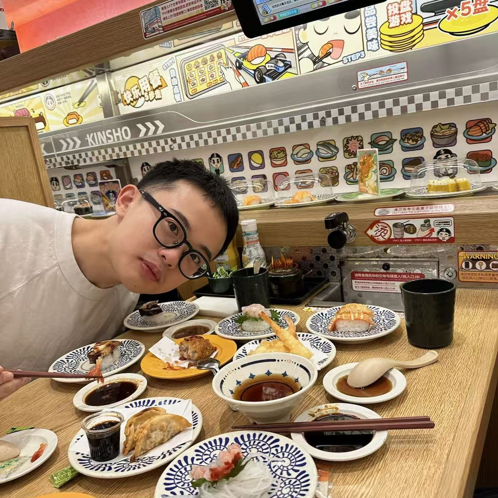

I am a fourth-year Ph.D. student of Shanghai Jiao Tong University ([SJTU](https://www.sjtu.edu.cn)). I am supervised by Prof. [Chao Dong](https://xpixel.group/2010/01/20/chaodong.html). Prior to that, I received my B.Eng. from Beijing Institute of Technology ([BIT](https://www.bit.edu.cn)) in 2023.

My current research interest mainly lies in generative modeling and agents.

# News
- **2026-10**: Our technical report on [Intern Lumina U2](https://arxiv.org/abs/2610.20818) is now available.
- **2026-09**: One paper was accepted to NeurIPS 2026.
- **2026-07**: One paper was accepted to ACM MM 2026.
- **2026-06**: One paper was accepted to ECCV 2026.
- **2026-05**: Recognized as a Gold Reviewer for ICML 2026.
- **2026-05**: Three papers were accepted to ICML 2026.
- **2026-02**: One paper was accepted to CVPR 2026.
- **2026-01**: Four papers were accepted to ICLR 2026.
- **2025-11**: One paper was accepted to AAAI 2026 as oral.
- **2024-07**: One paper was accepted to ACM MM 2024.
- **2024-07**: One paper was accepted to ECCV 2024.
- **2023-09**: I became a Ph.D student at XPixel in SJTU.

# Publications

\*: Equal Contribution, †: Corresponding Author

## Preprints

- **Intern Lumina U2: A Multi-Codebook Diffusion Large Language Model for Omni-Visual Understanding and Image Generation**  
    Qian Yu, Zongyang Qiu, Juncheng Yan, Hongliang Li, Qi Qin, Keqi Wang, Siqi Luo, Junkui Ju, Yapeng Mi, Tiantian Lu, Tian Liu, Pengyu Xie, Chenhao Ji, Minghui Zhang, Yiang Zhao, Siyu Yan, Haiying Xu, Yanbo Wang, Jianghan Shen, **Yuandong Pu**, Jiayi Lei, Borui Zhang, Jinxin Shi, Bo Zhang, Yuhang Zang, Shenglong Ye, Lixin Gu, Hongjie Zhang, Linghan Liu, Xinyuan Chen, Yuewen Cao, Lihe Zhang, Xiaohong Liu, Junjun He, Qiangwei Liu, Qi Zhang, Yu Cheng, Tianfan Xue, Hui Xiong, Chang Xu, Yu Qiao, Yihao Liu, Bin Fu  
    [arxiv](https://arxiv.org/abs/2610.20818) | [paper](https://arxiv.org/pdf/2610.20818) | [page](https://internlm.github.io/InternLumina-U2/) | [code](https://github.com/InternLM/InternLumina-U2)

- **PAWBench: How Far Are We from Probabilistically Aligned World Modeling?**  
    **Yuandong Pu**, Le Zhuo, Sayak Paul, Gabriel Jorge Menezes, Avram Đorđević, Shiyang Li, Yifan Zhou, Bin Fu, Wenlong Zhang, Junjun He, Yu Qiao, Yihao Liu†, Jinbo Xing, Xi Chen†  
    [arxiv](https://arxiv.org/abs/2608.27345) | [paper](https://arxiv.org/pdf/2608.27345) | [page](https://pawbench.github.io/) | [code](https://github.com/Andrew0613/PAWBench) | [benchmark](https://huggingface.co/datasets/Andrew613/PAWBench)

- **Towards Physics-Faithful Generation of Scientific Diagrams**  
    Minghui Zhang, Jinxin Shi, Yifan Chang, Liangliang Zhao, **Yuandong Pu**, Qian Yu, Ming Hu, Hanxiao Zhang, Yun Gu, Yirong Chen, Yu Qiao, Bo Zhang, Xiangchao Yan, Bin Fu, Yihao Liu  
    [arxiv](https://arxiv.org/abs/2608.13112) | [paper](https://arxiv.org/pdf/2608.13112)

- **AcoustiTrace: When Plausible Sound Violates Physics**  
    Shiyang Li, Yuewen Cao, Yihao Liu, **Yuandong Pu**, Baochang Zhang, Xiaofei Li, Changqing Zou  
    [arxiv](https://arxiv.org/abs/2608.02035) | [paper](https://arxiv.org/pdf/2608.02035)

- **Faithful, Enriched, and Precise: Benchmarking Natural-Science Illustration Generation by T2I models**  
    Yifan Chang, Jiaxin Ai, Jianwen Sun, **Yuandong Pu**, Siqi Luo, Liangliang Zhao, Yuchen Ren, Minghao Liu, Yunfei Yu, Yu Qiao, Kaipeng Zhang, Yihao Liu  
    [arxiv](https://arxiv.org/abs/2606.05949) | [paper](https://arxiv.org/pdf/2606.05949)

- **Project Imaging-X: A Survey of 1000+ Open-Access Medical Imaging Datasets for Foundation Model Development**  
    Zhongying Deng et al. (127 authors; including **Yuandong Pu**)  
    [arxiv](https://arxiv.org/abs/2603.27460) | [paper](https://arxiv.org/pdf/2603.27460) | [code](https://github.com/uni-medical/Project-Imaging-X)

- **Toward Generalizable Deblurring: Leveraging Massive Blur Priors with Linear Attention for Real-World Scenarios**  
    Yuanting Gao\*, Shuo Cao\*, Xiaohui Li, **Yuandong Pu**, Yihao Liu†, Kai Zhang†  
    [arxiv](https://arxiv.org/abs/2601.06525) | [paper](https://arxiv.org/pdf/2601.06525) | [page](https://vegdog007.github.io/GLOWDeblur_Website/) | [code](https://github.com/VegDog007/GLOWDeblur)

- **Lumina-DiMOO: An Omni Diffusion Large Language Model for Multi-Modal Generation and Understanding**  
    Yi Xin, Qi Qin, Siqi Luo, Kaiwen Zhu, Juncheng Yan, Yan Tai, Jiayi Lei, Yuewen Cao, Keqi Wang, Yibin Wang, Jinbin Bai, Qian Yu, Dengyang Jiang, **Yuandong Pu**, Haoxing Chen, Le Zhuo, Junjun He, Gen Luo, Tianbin Li, Ming Hu, Jin Ye, Shenglong Ye, Bo Zhang, Chang Xu, Wenhai Wang, Hongsheng Li, Guangtao Zhai, Tianfan Xue, Bin Fu, Xiaohong Liu, Yu Qiao, Yihao Liu†  
    [arxiv](https://arxiv.org/abs/2510.06308) | [paper](https://arxiv.org/abs/2510.06308) | [page](https://synbol.github.io/Lumina-DiMOO/) | [code](https://github.com/Alpha-VLLM/Lumina-DiMOO)

- **Exploring Scalable Unified Modeling for General Low-Level Vision**  
    Xiangyu Chen, Kaiwen Zhu, **Yuandong Pu**, Shuo Cao, Xiaohui Li, Wenlong Zhang, Yihao Liu, Yu Qiao, Jiantao Zhou, Chao Dong†  
    [arxiv](https://arxiv.org/abs/2507.14801) | [paper](https://arxiv.org/abs/2507.14801)

## Conference Papers

- **Are Text-to-Image Models Inductivist Turkeys? A Counterfactual Benchmark for Causal Reasoning**  
    Jiayi Lei, **Yuandong Pu**, Xingyu Han, Rongpeng Zhu, Jing Xu, Jinyao Wang, Zijian Zhou, Bin Fu, Yuewen Cao, Yihao Liu, Hongsheng Li  
    NeurIPS 2026  
    [arxiv](https://arxiv.org/abs/2606.24548) | [paper](https://arxiv.org/pdf/2606.24548) | [page](https://jylei16.github.io/CF-World.github.io/)

- **Accelerating Masked Image Generation by Learning Controlled Latent Dynamics**  
    Kaiwen Zhu, Quansheng Zeng, **Yuandong Pu**, Shuo Cao, Xiaohui Li, Yi Xin, Qi Qin, Jiayang Li, Juncheng Yan, Yu Qiao, Jinjin Gu, Yihao Liu  
    ACM MM 2026  
    [arxiv](https://arxiv.org/abs/2602.23996) | [paper](https://arxiv.org/pdf/2602.23996) | [code](https://github.com/Kaiwen-Zhu/MIGM-Shortcut)

- **Lumina-OmniLV: A Unified Multimodal Framework for General Low-Level Vision**  
    **Yuandong Pu**, Le Zhuo, Kaiwen Zhu, Liangbin Xie, Wenlong Zhang, Xiangyu Chen, Peng Gao, Yu Qiao, Chao Dong, Yihao Liu†  
    ECCV 2026  
    [arxiv](https://arxiv.org/abs/2504.04903) | [paper](https://arxiv.org/abs/2504.04903) | [page](https://andrew0613.github.io/OmniLV_page/)

- **UniPercept: Towards Unified Perceptual-Level Image Understanding across Aesthetics, Quality, Structure, and Texture**  
    Shuo Cao, Jiayang Li, Xiaohui Li, **Yuandong Pu**, Kaiwen Zhu, Yuanting Gao, Siqi Luo, Yi Xin, Qi Qin, Yu Zhou, Xiangyu Chen, Wenlong Zhang, Bin Fu, Yu Qiao, Yihao Liu  
    ICML 2026 Spotlight 
    [arxiv](https://arxiv.org/abs/2512.21675) | [paper](https://arxiv.org/abs/2512.21675) | [page](https://thunderbolt215.github.io/Unipercept-project/) | [code](https://github.com/thunderbolt215/UniPercept)

- **UniMedVL: Unifying Medical Multimodal Understanding And Generation Through Observation-Knowledge-Analysis**  
    Junzhi Ning, Wei Li, Cheng Tang, Jiashi Lin, Chenglong Ma, Chaoyang Zhang, Jiyao Liu, Ying Chen, Shujian Gao, Lihao Liu, **Yuandong Pu**, Huihui Xu, Chenhui Gou, Ziyan Huang, Yi Xin, Qi Qin, Zhongying Deng, Diping Song, Bin Fu, Guang Yang, Yuanfeng Ji, Tianbin Li, Yanzhou Su, Jin Ye, Shixiang Tang, Ming Hu, Junjun He†  
    ICML 2026  
    [arxiv](https://arxiv.org/abs/2510.15710) | [paper](https://arxiv.org/abs/2510.15710) | [code](https://github.com/uni-medical/UniMedVL)

- **MICE-Bench: A Challenging and Comprehensive Benchmark for Multi-Reference Image Creation and Editing**  
    Siqi Luo, Huayu Zheng, Jianghan Shen, Yi Xin, Luxin Xu, Jiyao Liu, Xinyu Zhang, Hang Zhou, Pengyu Xie, Xiaohui Li, Shuo Cao, **Yuandong Pu**, Junjun He, Bin Fu, Yihao Liu, Yu Qiao, Guangtao Zhai, Yuewen Cao, Xiaohong Liu  
    ICML 2026  
    [openreview](https://openreview.net/forum?id=2p9PIlKD6q) | [paper](https://openreview.net/pdf?id=2p9PIlKD6q)

- **ArtiMuse: Fine-Grained Image Aesthetics Assessment with Joint Scoring and Expert-Level Understanding**  
    Shuo Cao, Nan Ma, Jiayang Li, Xiaohui Li, Lihao Shao, Kaiwen Zhu, Yu Zhou, **Yuandong Pu**, Jiarui Wu, Jiaquan Wang, Bo Qu, Wenhai Wang, Yu Qiao, Dajuin Yao, Yihao Liu†  
    CVPR 2026  
    [arxiv](https://arxiv.org/abs/2507.14533) | [paper](https://arxiv.org/abs/2507.14533) | [page](https://thunderbolt215.github.io/ArtiMuse-project/) | [code](https://github.com/thunderbolt215/ArtiMuse)

- **Omni-Weather: Unified Multimodal Foundation Model for Weather Generation and Understanding**  
    Zhiwang Zhou\*, **Yuandong Pu\***, Xuming He, Yidi Liu, Yixin Chen, Junchao Gong, Xiang Zhuang, Wanghan Xu, Qinglong Cao, Shixiang Tang, Yihao Liu, Wenlong Zhang, Lei Bai  
    ICLR 2026  
    [arxiv](https://arxiv.org/abs/2512.21643) | [paper](https://arxiv.org/pdf/2512.21643)

- **PICABench: How Far Are We from Physically Realistic Image Editing?**  
    **Yuandong Pu**, Le Zhuo, Songhao Han, Jinbo Xing, Kaiwen Zhu, Shuo Cao, Bin Fu, Si Liu, Hongsheng Li, Yu Qiao, Wenlong Zhang, Xi Chen†, Yihao Liu†  
    ICLR 2026  
    [arxiv](https://arxiv.org/abs/2510.17681) | [paper](https://arxiv.org/pdf/2510.17681) | [page](https://picabench.github.io) | [code](https://github.com/Andrew0613/PICABench) 

- **LinearSR: Unlocking Linear Attention for Stable and Efficient Image Super-Resolution**  
    Xiaohui Li, Shaobin Zhuang, Shuo Cao, Yang Yang, **Yuandong Pu**, Qi Qin, Siqi Luo, Bin Fu, Yihao Liu†  
    ICLR 2026  
    [arxiv](https://arxiv.org/abs/2510.08771) | [paper](https://arxiv.org/pdf/2510.08771)

- **Factuality Matters: When Image Generation and Editing Meet Structured Visuals**  
    Le Zhuo\*, Songhao Han\*, **Yuandong Pu**, Boxiang Qiu, Sayak Paul, Yue Liao, Yihao Liu, Jie Shao, Xi Chen, Si Liu, Hongsheng Li†  
    ICLR 2026  
    [arxiv](https://arxiv.org/abs/2510.05091) | [paper](https://arxiv.org/abs/2510.05091) | [page](https://structvisuals.github.io) | [code](https://github.com/zhuole1025/Structured-Visuals)

- **SynWeather: Weather Observation Data Synthesis across Multiple Regions and Variables via a General Diffusion Transformer**  
    Kaiyi Xu, Junchao Gong, Zhiwang Zhou, Zhangrui Li, **Yuandong Pu**, Yihao Liu, Ben Fei, Fenghua Ling, Wenlong Zhang, Lei Bai  
    AAAI 2026 Oral 
    [arxiv](https://arxiv.org/abs/2511.08291) | [paper](https://arxiv.org/pdf/2511.08291)

- **Learning A Low-Level Vision Generalist via Visual Task Prompt**  
    Xiangyu Chen, Yihao Liu, **Yuandong Pu**, Wenlong Zhang, Jiantao Zhou, Yu Qiao, Chao Dong†  
    ACM MM 2024  
    [arxiv](https://arxiv.org/abs/2408.08601) | [paper](https://arxiv.org/pdf/2408.08601)

- **A Comparative Study of Image Restoration Networks for General Backbone Network Design**  
    Xiangyu Chen\*, Zheyuan Li\*, **Yuandong Pu\***, Yihao Liu, Jiantao Zhou, Yu Qiao, Chao Dong†  
    ECCV 2024  
    [arxiv](https://arxiv.org/abs/2310.11881) | [paper](https://arxiv.org/abs/2310.11881) | [code](https://github.com/Andrew0613/X-Restormer)

# Academic Service

- **Gold Reviewer**: ICML 2026
- **Reviewer**: ICML 2026, ICLR 2026, ICCV 2025
- **Area Chair**: 2nd Workshop on Human-Interactive Generation and Editing

# Education

- **Ph.D. Student in Electronic Engineering @ Shanghai Jiao Tong University**  
  Sep. 2023 - Current  
  Advisor: Prof. [Chao Dong](https://xpixel.group/2010/01/20/chaodong.html)

- **B.Eng. in Artificial Intelligence @ Beijing Institute of Technology**  
  Sep. 2019 - Jun. 2023  
  GPA: 3.8 / 4.0, **Ranking: 1 / 79**

(last updated: Oct 26, 2026)
